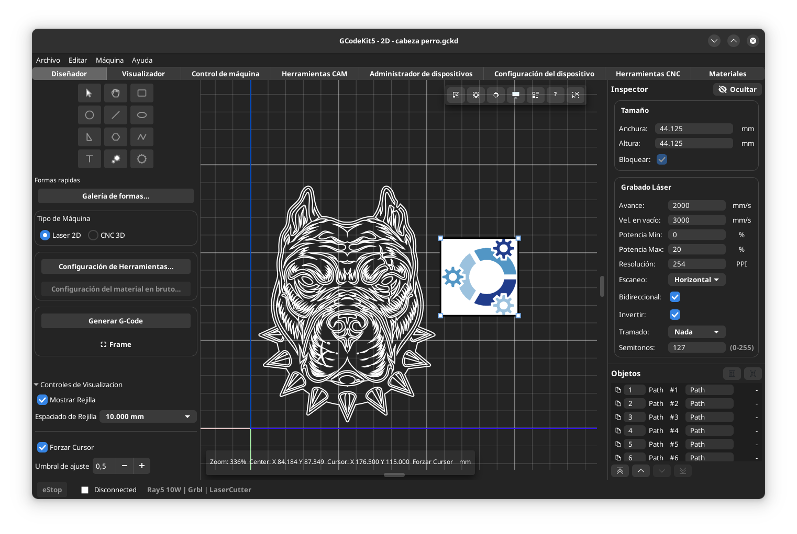
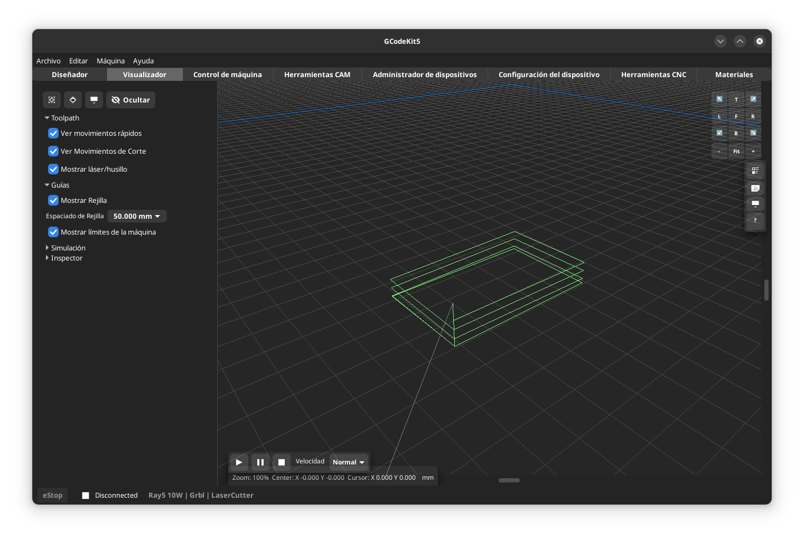
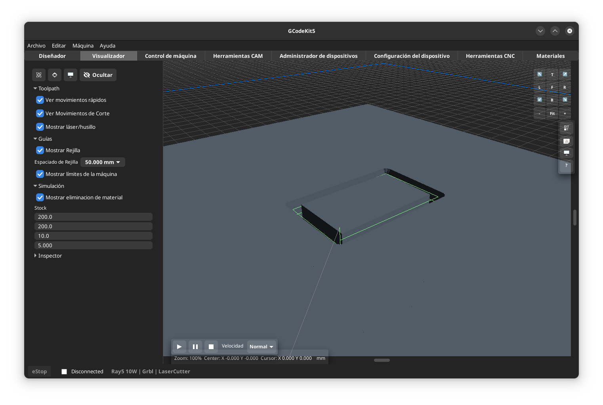
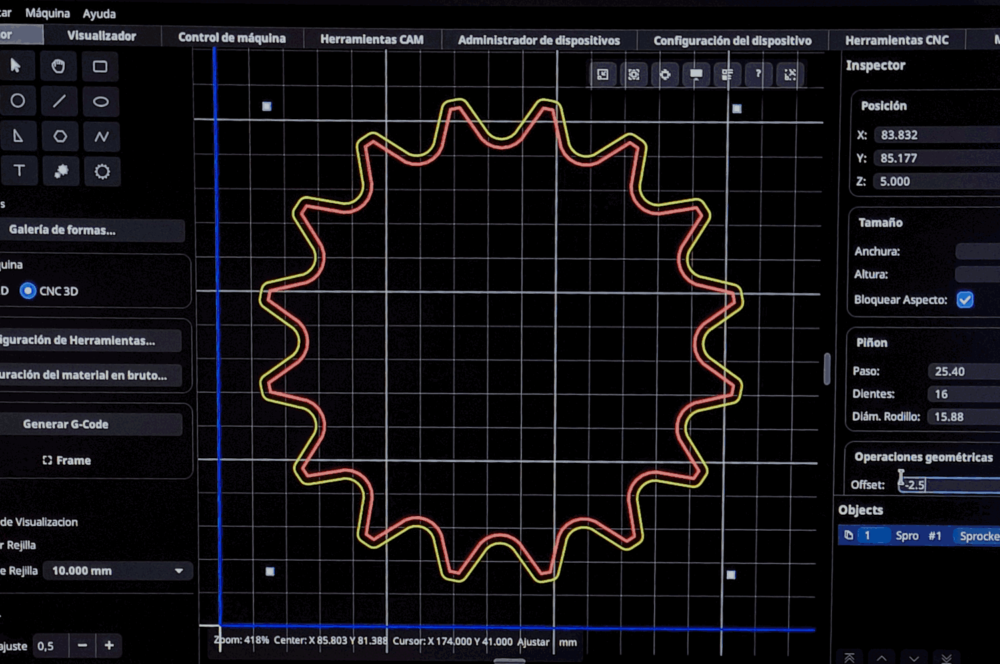
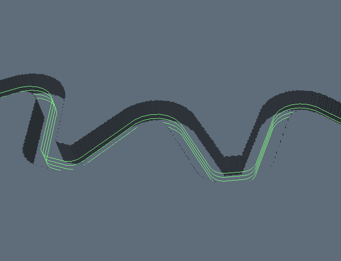
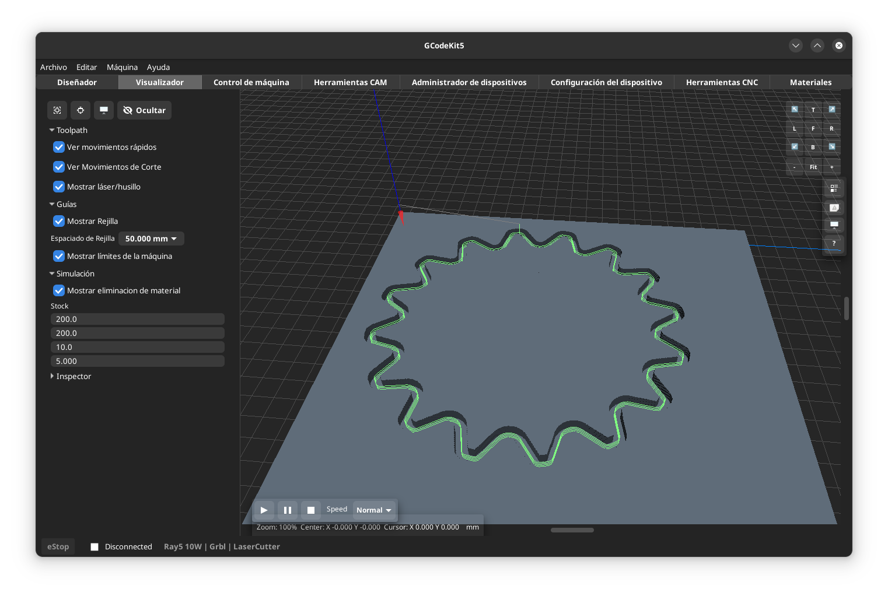

# GCodeKit6-Design

A modern, cross-platform G-Code sender for Laser and CNC machine controller written in Rust with an egui user interface (eframe and wgpu, with the craft-libs
window, menu, keymap and dialog crates).

[](LICENSE-MIT)
[](LICENSE-APACHE)

## Overview

GCodeKit6 is a Rust-based CNC and laser machine controller providing a modern alternative to Universal G-Code Sender. It drives GRBL (including grblHAL and FluidNC) and Repetier controllers through one interface built with egui, and includes a 2D/3D designer, a toolpath visualizer and a set of CAM tools. See [Supported Controllers](#supported-controllers).



## Architecture

GCodeKit6 is a Cargo workspace with one library crate per directory under `crates/`, plus the
root `gcodekit6` binary package (`cargo metadata --no-deps --format-version 1 | jq '.packages|length'`
prints 10):

- **gcodekit6-core** - Core types, traits, state management, events, and data models
- **gcodekit6-camtools** - CAM tools and special G-code processing operations
- **gcodekit6-designer** - Visual design tools and toolpath generation
- **gcodekit6-communication** - Serial, TCP, WebSocket protocols and firmware implementations (GRBL family and Repetier)
- **gcodekit6-app** - Toolkit-free application logic: the machine controller worker, work zero, translations and command history
- **gcodekit6-ui-egui** - The egui front end: pages, panes, visualizer, designer, CAM tools, managers, editor and settings
- **gcodekit6-devicedb** - Device profile management
- **gcodekit6-settings** - Application settings management
- **gcodekit6-visualizer** - 2D/3D visualization engine
- **gcodekit6** - Main binary that integrates all crates

See [ARCHITECTURE.md](ARCHITECTURE.md) for the crate dependency graph and data flow.

## Features

### Machine Control
- **6-axis positions**: X, Y, Z linear axes and A, B, C rotary axes
- **DRO and status bar**: machine state, position, feed rate and spindle speed, polled every 200 ms
- **Jogging**: step or continuous (hold-to-jog) mode, with the numeric keypad in Machine Control
- **Work coordinates**: Zero buttons and a G54-G59 selector (Repetier, which has no work coordinate systems, zeroes with `G92`)
- **Home and Unlock**: `$H` homing cycle and `$X` alarm unlock
- **E-STOP**: the status bar eStop button sends a soft reset
- **Real-time overrides**: feed, rapid and spindle
- **G-code editor in Machine Control**: open, edit and stream a file from the same page, with the console beside it
- **Streaming**: GRBL character-counting flow control, Repetier numbered and checksummed lines, progress bar, Pause (feed hold), Resume and Stop

### Device Management
- **Connections**: serial, TCP and WebSocket, with Auto Reconnect
- **Device Manager**: machine profiles (CNC mill, CNC lathe, laser cutter, 3D printer and plotter)
- **Device Config**: read and edit GRBL settings, and read Repetier EEPROM parameters
- **Console**: device communication log with command history

### 2D/3D CAD/CAM Designer
- **Drawing tools**: rectangles, circles, ellipses, lines, polylines, triangles, polygons, and parametric pinions, gears, sprockets and timing pulleys from the Shape Gallery
- **Chain sprockets**: enter the pitch and number of teeth; the roller diameter is derived from the pitch
- **Import**: SVG and DXF vector files (DXF as updated to AutoCAD 2018, with splines; AutoCAD ACIS objects cannot be imported), and raster images (`Import Image...`)
- **Editing**: zoom, pan (Pan tool or middle mouse drag), grid snap, arrays, alignment (Align Left/Right/Top/...), grouping, undo/redo, copy/paste
- **Per-object properties**: each object can use the global laser or CAM settings, or its own values (untick "Use global values")
- **Images and vectors together**: several images and vector objects on one canvas, cut in the order set in the object list; each image has its own engraving settings; images are saved in the `.gckd` file
- **CNC 3D mode**: objects have depth, and the Z passes follow the Global CAM Properties (or the object's own values). The G-code path begins at the top of the stock; Z depth is entered as a positive value and cut as -Z. A safety Z height is added to the stock thickness before the first plunge
- **Boundary check**: G-code that falls outside the machine working area gets a warning comment in the G-code and a warning dialog
- **Toolpath generation**: designs to G-code, plus a Frame button that generates bounds G-code





To machine chain sprockets and gears, create the element in the Designer (pitch, number of teeth,
and so on), then add an external offset equal to the cutter radius so the cut lands on the profile.







### Visualizer
- **2D/3D toggle**: a locked top-down 2D view (left-drag pans) or the free-orbit 3D view
- **3D rendering**: toolpath depths drawn with the configured tool diameter (CNC machines)
- **Play preview**: replay the tool movement at several speeds, for 2D and 3D programs
- **Controls**: zoom, pan, orbit and fit-to-view
- **Color-coded paths**: rapid (G0) and feed (G1/G2/G3) moves in distinct colors

### Tool and Material Libraries
- **CNC Tools**: create, edit and delete tools; import GTC (Generic Tool Catalog) packages (`.zip`) and catalogs (`.json`)
- **Materials**: material library with cutting parameters

### CAM Tools
- **Jigsaw Puzzle Generator**, based on [Draradech's jigsaw generator](https://github.com/Draradech/jigsaw)
- **Tabbed Box Maker**, based on the [TabbedBoxMaker algorithm](https://github.com/paulh-rnd/TabbedBoxMaker)
- **Laser Image Engraver**: bitmap images to raster G-code with grayscale power control
- **Speeds and Feeds Calculator**
- **Spoilboard Surfacing** and **Create Spoilboard Grid**
- **Gerber to G-Code**, including Excellon drill files
- **Drill Press**: peck drilling and helical interpolation for holes larger than the tool
- **Probe Tools**

### Help and Translations
- **In-app help**: F1 opens the documentation, with images for each module
- **Translations**: German, Spanish, French, Italian and Portuguese (`po/*.po`)

## Supported Controllers

| Controller | Status |
|-----------|--------|
| **GRBL** | Supported |
| **Repetier** | Supported |
| **grblHAL** | Supported via GRBL |
| **FluidNC** | Supported via GRBL |
| **TinyG** | Detected, not supported |
| **g2core** | Detected, not supported |
| **Smoothieware** | Detected, not supported |
| **Marlin** | Detected, not supported |

grblHAL and FluidNC are driven with the GRBL protocol. A machine profile with an unsupported
controller cannot be saved. Sources: `crates/gcodekit6-communication/src/firmware/protocol_registry.rs`
and `CONTROLLER_CHOICES` in `crates/gcodekit6-app/src/device_profiles.rs`.

## Installation

### Prerequisites
- **Rust** 1.95 or later (MSRV - Minimum Supported Rust Version)
- **Operating System**: Linux, macOS, or Windows
- **Linux libraries**: see [DEVELOPMENT.md](DEVELOPMENT.md) (the CI list is in
  `.github/actions/install-system-deps/action.yml`). Running needs a Vulkan or OpenGL driver for wgpu.

### Build from Source
```bash
# Clone the repository
git clone https://github.com/thawkins/gcodekit6.git
cd gcodekit6

# Build release version (optimized)
cargo build --release

# Run the application (optionally with files to open)
./target/release/gcodekit6

# Print the version or the usage
./target/release/gcodekit6 --version
./target/release/gcodekit6 --help
```

The GTK4 front end has been removed; egui is the only front end. Features ported from it,
and the manual checks still pending before release, are listed in
[docs/reports/egui-parity.md](docs/reports/egui-parity.md).

## Quick Start Guide

See the [User Guide](docs/user/README.md) for the full walkthrough.

### 1. Connect to Your CNC Controller
1. Launch GCodeKit6
2. Click **Refresh ports** to detect available serial devices
3. Select your controller's port from the dropdown
4. Choose baud rate (typically **115200** for GRBL)
5. Click **Connect**

### 2. Initialize Machine
1. Click **Home** to run the homing cycle
2. The DRO shows the current position and the status bar shows the machine state

### 3. Jog Machine
1. Select a step size
2. Click the X/Y/Z (and A/B, if configured) jog buttons, or use the numeric keypad
   (4/6 X, 8/2 Y, 9/3 Z) while Machine Control has the keyboard

### 4. Load and Run G-Code
1. Click **File > Open** (Ctrl+O) and pick a `.nc`/`.gcode` file
2. Review the code in the editor
3. Click **Send** to execute
4. Monitor progress in the status bar and console

### 5. Configure Settings
1. Open the **Device Config** page
2. Read and edit the controller settings

## Keyboard Shortcuts

| Key | Action |
|-----|--------|
| **Ctrl+Shift+K** | E-STOP (soft reset) |
| **!** | Feed hold |
| **Ctrl+O** | Open file |
| **Ctrl+S** | Save file |

The full list is in [docs/user/90-shortcuts.md](docs/user/90-shortcuts.md).

## Technology Stack
- **Rust**: System programming language for memory safety and performance
- **egui / eframe**: Immediate-mode UI, drawn with wgpu (the visualizer renders with wgpu too)
- **craft-libs**: Window, native menu, keyboard shortcuts and native file dialogs (see [ADR-012](docs/adr/ADR-012-egui-craft-libs.md))
- **Serialport-rs**: Cross-platform serial communication
- **Tracing**: Structured logging and diagnostics
- **Serde**: Serialization/deserialization
- **Anyhow**: Error handling with context

## Configuration

Settings files are stored in platform-specific locations:

- **Linux**: `~/.config/gcodekit6/config.toml`
- **macOS**: `~/Library/Application Support/gcodekit6/config.toml`
- **Windows**: `%APPDATA%\gcodekit6\config.toml`

On first start the app imports the settings and data files of the older GTK builds (`config.json` and the JSON data files beside it). The old files are left unchanged.

On the first start after the rename from GCodeKit5, an existing `gcodekit5` settings folder is
copied to `gcodekit6` (once, only when `gcodekit6` does not exist yet); the old folder is left
unchanged. `GCODEKIT5_CONFIG_DIR` and `GCODEKIT5_TITLEBAR` are still read when the `GCODEKIT6_`
variable is not set. The Flatpak build also copies the settings of the
`com.github.thawkins.gcodekit5` Flatpak (from `~/.var/app/com.github.thawkins.gcodekit5`, which
it may read but not change), so a Flatpak upgrade keeps your settings.

## Development

Debug builds, tests (`cargo nextest`), formatting, Clippy, logging (`RUST_LOG`) and the Podman
development container (`.devcontainer/`) are covered in [DEVELOPMENT.md](DEVELOPMENT.md).

## Contributing

Contributions are welcome. See **[CONTRIBUTING.md](CONTRIBUTING.md)** for code style, branch
naming, commit format, the pull request process and testing requirements.

## Known Issues

See [GitHub Issues](https://github.com/thawkins/gcodekit6/issues) for the current bug tracker.

## Documentation

- **[docs/user/](docs/user/README.md)** - **Comprehensive User Guide** (start here!)
- **[DEVELOPMENT.md](DEVELOPMENT.md)** - Developer setup guide
- **[CONTRIBUTING.md](CONTRIBUTING.md)** - Contribution guidelines
- **[ARCHITECTURE.md](ARCHITECTURE.md)** - System architecture overview
- **[docs/adr/](docs/adr/)** - Architecture Decision Records (ADRs)
- **[docs/COORDINATE_SYSTEM.md](docs/COORDINATE_SYSTEM.md)** - Coordinate system and Y-flip explanation
- **[SPEC.md](SPEC.md)** - As-built specification
- **[AGENTS.md](AGENTS.md)** - Development guidelines
- **[AGENTS-LANGUAGE.md](AGENTS-LANGUAGE.md)** - Rust-specific development guidelines
- **[CHANGELOG.md](CHANGELOG.md)** - Version history
- **[STATS.md](STATS.md)** - Project statistics
- **[docs/](docs/)** - Additional documentation and guides

## License

This project is dual-licensed under:

- **MIT License** - See [LICENSE-MIT](LICENSE-MIT) for details
- **Apache License 2.0** - See [LICENSE-APACHE](LICENSE-APACHE) for details

You may choose either license for your use of this software.

## Acknowledgments

- **Inspiration**: Universal G-Code Sender (UGS) project
- **Frameworks**: the egui, eframe, winit and wgpu projects
- **Firmware**: GRBL, Repetier and other open-source CNC firmware projects
- **Community**: Rust community for excellent tooling and support

## Third-party assets

- **Icons**: the egui front end's toolbar and button icons are from
  [Tabler Icons](https://tabler.io/icons) 3.31.0 (c) Pawel Kuna, MIT License. The SVGs the
  code uses and the licence text are in `crates/gcodekit6-ui-egui/resources/icons/tabler/`.

## Support

- **Bug Reports**: [GitHub Issues](https://github.com/thawkins/gcodekit6/issues)
- **Feature Requests**: [GitHub Discussions](https://github.com/thawkins/gcodekit6/discussions)
- **Email**: tim.thawkins@gmail.com
- **Documentation**: See docs/ folder and SPEC.md

## Project Status

- **Status**: Active Development
- **Stability**: Alpha (the current version is in `Cargo.toml`)

Release history: see [CHANGELOG.md](CHANGELOG.md).

This project is in active development. New features are being added regularly, and breaking changes may occur between versions. Use in production environments is at your own risk.
